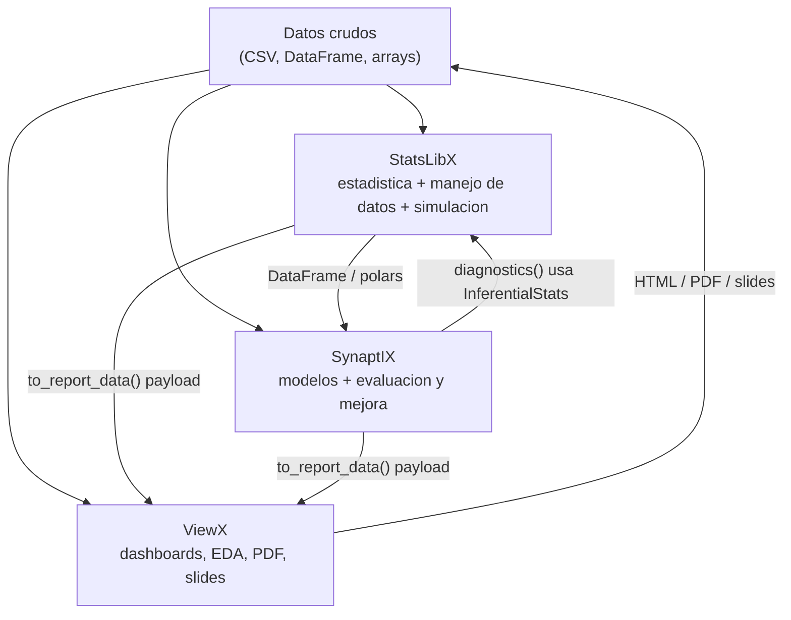

# SynaptIX

**Librería integral de Machine Learning para Python.** Una API unificada y en español que cubre aprendizaje supervisado, no supervisado, por refuerzo, redes neuronales y preprocesamiento de datos — pensada para AI Engineers y analistas de modelos.

**Documentación completa + playground en línea:** https://synaptix-blue.vercel.app/ (sitio Next.js en `web/` de este repo — el `docs-web/` anterior queda deprecado tras la migración).

```bash
pip install synaptix            # núcleo (sklearn incluido)
pip install synaptix[dl]        # + tensorflow (redes neuronales y DQN)
pip install synaptix[bayes]     # + pymc (inferencia bayesiana completa)
pip install synaptix[viewx]     # + ViewX (dashboards HTML, PDF, presentaciones)
pip install synaptix[stats]     # + StatsLibX (diagnóstico estadístico de modelos)
pip install synaptix[polars]    # + polars (DataFrames polars como entrada)
pip install synaptix[all]       # todo
```

## Inicio rápido

```python
import synaptix as sx

# 1. Cargar un dataset incluido
df = sx.load_dataset("iris")

# 2. Preparar los datos
X, y = df.drop(columns="species"), df["species"]
X_train, X_test, y_train, y_test = sx.preprocessing.train_test_split(
    X, y, test_size=0.2, random_state=42
)

# 3. Entrenar y evaluar
model = sx.supervised.RandomForestClassifier(n_estimators=100)
model.fit(X_train, y_train)
model.evaluate(X_test, y_test, plot=True)  # métricas + matriz de confusión

# O dividir, entrenar y ver métricas de train y test en un paso
resultado = model.fit_evaluate(X, y, test_size=0.2, metrics=["accuracy", "f1", "mcc"])
print(resultado.to_frame())                # métrica | train | test | diferencia
```

`fit_evaluate(..., test_size=..., metrics=[...])` existe en todos los modelos: supervisados, clustering, PCA, redes neuronales (split temporal en `LSTMNet`) y agentes de refuerzo (donde `test_size` es la fracción de episodios de evaluación).

## Novedades en v0.2.0

- `fit_evaluate(...)` en todos los modelos: divide, entrena y devuelve un `TrainTestResult` con métricas de train y test.
- Selección de métricas con `metrics=[...]` en todas las funciones de `synaptix.metrics` y `available_metrics()` para listarlas.
- `compare_models` acepta `test_size`, `models` y `metrics`, reporta métricas de train y test con columna de sobreajuste y soporta clustering; nuevo `list_models`.

## Módulos

| Módulo | Contenido |
|---|---|
| `synaptix.pipeline` | `AutoPipeline` (ML automático de principio a fin) y `Pipeline` declarativo por pasos |
| `synaptix.preprocessing` | `Scaler`, `Encoder`, `Imputer`, `DataCleaner` (con `transform` para datos nuevos), `detect_outliers`, `remove_outliers`, `train_test_split` |
| `synaptix.supervised` | 8 regresores, 7 clasificadores y 9 modelos bayesianos (BayesianRidge, ARD, procesos gaussianos, variantes de Naive Bayes, PyMC) |
| `synaptix.unsupervised` | `KMeans` (con codo y silhouette), `DBSCAN`, `HierarchicalClustering`, `GaussianMixture`, `PCA`, `TSNE` |
| `synaptix.reinforcement` | `QLearningAgent`, `SARSAAgent`, `DQNAgent`, entorno `GridWorld` |
| `synaptix.neural` | `MLP`, `CNN`, `LSTMNet` sobre Keras (requiere `synaptix[dl]`) |
| `synaptix.metrics` | `regression_metrics`, `classification_metrics`, `clustering_metrics`, `classification_report`, `available_metrics` (todas con `metrics=[...]`) |
| `synaptix.model_selection` | `cross_validate`, `GridSearch`, `compare_models` (AutoML-lite con métricas de train y test), `list_models` |
| `synaptix.visualization` | Gráficas de modelos (matriz de confusión, ROC, curva de aprendizaje, residuos, frontera de decisión, `model_report`) y EDA (distribuciones, correlación, boxplots, scatter matrix, nulos) |
| `synaptix.datasets` | `iris`, `penguins`, `titanic`, `sp500_companies`, `course_completion` (compatible con `backend="polars"` y `return_X_y=True`) |
| `synaptix.legacy` | API clásica v0.x (`IntelligenceArtificial`, `MachineLearning`, ...) |
| `synaptix.viewx` | Puente opcional a ViewX: `to_report_data`, `render_html/report/presentation` (requiere `synaptix[viewx]`) |
| `synaptix.viz` | Figuras Plotly para exportación (matriz de confusión, ROC, residuos, comparación de modelos; requiere `synaptix[viz]`) |

## Ejemplos por área

### AutoPipeline: ML en una línea (para empezar sin experiencia)

```python
import synaptix as sx

df = sx.load_dataset("penguins")

pipe = sx.AutoPipeline()          # el sistema se encarga de los parámetros
pipe.fit(df, target="species")    # limpia, compara 7 modelos, ajusta y evalúa
pipe.report()                     # ranking + métricas + matriz de confusión

predicciones = pipe.predict(df_nuevo)   # acepta datos crudos (con nulos)
pipe.save("mi_pipeline.pkl")
```

Todo es configurable: `AutoPipeline(models=["random_forest", "svm"], cv=10, tune=False, scale_method="robust", param_grids={"random_forest": {"n_estimators": [300]}})`.

También hay un `Pipeline` declarativo por pasos, donde el sistema rellena los parámetros de cada paso:

```python
from synaptix.pipeline import Pipeline

pipe = Pipeline([
    "clean",                            # DataCleaner con defaults
    ("outliers", {"columns": ["bill_length_mm", "body_mass_g"]}),  # params propios opcionales
    ("model", "random_forest"),         # o "model" solo = elegir automático
    "tune",                             # rejilla por defecto del modelo
    ("evaluate", {"plot": True}),
])
pipe.fit(df, target="species")
pipe.model_, pipe.results_, pipe.best_params_   # modelo, métricas de test, parámetros
pipe.predict(df_nuevo)
```

Atributos de `AutoPipeline` tras `fit`: `task_`, `cleaner_`, `ranking_`, `best_model_`, `best_name_`, `best_params_`, `results_`; métodos `predict`, `predict_proba`, `report(plot=True)`, `save(path)` y `AutoPipeline.load(path)`.

### Modelos bayesianos (con incertidumbre)

```python
from synaptix.supervised import BayesianRidgeRegression, GaussianProcessRegressor

model = BayesianRidgeRegression()
model.fit(X_train, y_train)

# Además de la predicción puntual, un intervalo de incertidumbre:
media, inferior, superior = model.predict_interval(X_test, std=2)  # ~95%
```

Con el extra `[bayes]` (PyMC) se obtiene la distribución posterior completa:

```python
from synaptix.supervised import PyMCLinearRegression

model = PyMCLinearRegression(draws=1000)
model.fit(X_train, y_train)                       # inferencia MCMC
media, low, high = model.predict_interval(X_test, hdi=0.94)
print(model.summary())                            # resumen ArviZ de cada parámetro
model.plot_posterior()
```

### Preprocesamiento

```python
from synaptix.preprocessing import DataCleaner

cleaner = DataCleaner(impute_strategy="median", scale_method="standard")
cleaner.analyze(df)                    # reporte: nulos, outliers, tipos
df_listo = cleaner.clean(df, target="precio")
```

### Comparar modelos automáticamente

```python
from synaptix.model_selection import compare_models

tabla = compare_models(X, y, task="classification", cv=5)
# Entrena 7 modelos con validación cruzada y devuelve un ranking

# Elegir test_size, modelos y métricas; incluye métricas de train y columna "sobreajuste"
tabla = compare_models(
    X, y, test_size=0.3,
    models=["RandomForestClassifier", "LogisticRegression"],
    metrics=["accuracy", "f1"],
)

# Clustering: sin y
compare_models(X, task="clustering", test_size=0.2, n_clusters=3)
```

### Clustering (no supervisado)

```python
from synaptix.unsupervised import KMeans

KMeans.elbow(X, k_max=10)              # elegir k con el método del codo
km = KMeans(n_clusters=3)
labels = km.fit_predict(X)
km.plot(X)                             # scatter coloreado por cluster
print(km.silhouette(X))
```

### Aprendizaje por refuerzo

```python
from synaptix.reinforcement import GridWorld, QLearningAgent

env = GridWorld(rows=5, cols=5, obstacles=[(1, 1), (2, 3)])
agent = QLearningAgent(env.n_states, env.n_actions)
agent.train(env, episodes=500)
agent.plot_rewards()
env.render(agent.policy())             # política aprendida con flechas
```

### Redes neuronales

```python
from synaptix.neural import MLP, LSTMNet

# Clasificación tabular
net = MLP(task="classification", hidden_layers=(64, 32), dropout=0.2)
net.fit(X_train, y_train, epochs=50)
net.evaluate(X_test, y_test)
net.plot_history()

# Series de tiempo
lstm = LSTMNet(window=12, units=(64,))
lstm.fit(serie, epochs=50)
futuro = lstm.forecast(serie, steps=6)
```

### Gráficas a partir de datos y modelos

```python
from synaptix.visualization import (
    plot_distributions,     # histogramas de todas las numéricas
    plot_correlation,       # heatmap de correlación
    plot_boxplots,          # outliers, segmentables por categoría
    plot_missing,           # % de nulos por columna
    plot_residuals,         # diagnóstico de regresión
    plot_decision_boundary, # frontera de decisión 2D
    model_report,           # reporte visual completo en una llamada
)

plot_correlation(df)
plot_boxplots(df, by="species")
model_report(modelo, X_test, y_test)  # métricas + gráficos según la tarea
```

### Búsqueda de hiperparámetros

```python
from synaptix.supervised import RandomForestClassifier
from synaptix.model_selection import GridSearch

search = GridSearch(
    RandomForestClassifier(),
    {"n_estimators": [50, 100, 200], "max_depth": [3, 5, None]},
)
mejor_modelo = search.fit(X, y)
print(search.best_params_)
```

## Integración con ViewX y StatsLibX

SynaptIX es el **motor de machine learning** del ecosistema GhostAnalyst, junto con [StatsLibX](https://github.com/GhostAnalyst30/StatsLibX) (estadística) y [ViewX](https://github.com/GhostAnalyst30/ViewX) (visualización y reportes). Las tres comparten el mismo contrato de payload y cargadores de datasets, y **cada una funciona por separado**:



SynaptIX hace **todo el machine learning**; las integraciones son opcionales y cada librería funciona por separado.

### Flujo completo del ecosistema (StatsLibX → SynaptIX → ViewX)

```python
# pip install statslibx[viewx] synaptix[viewx,stats] viewx
from statslibx import DescriptiveStats, load_iris
import synaptix as sx
from viewx import from_report_payload

df = load_iris()

# 1. Estadística y calidad de datos (StatsLibX)
DescriptiveStats(df).summary()

# 2. Modelo, evaluación y diagnóstico estadístico (SynaptIX + StatsLibX)
X, y = df.drop(columns="species"), df["species"]
modelo = sx.supervised.RandomForestClassifier().fit(X, y)
evaluacion = modelo.evaluate(X, y)
diagnostico = modelo.diagnostics(X, y)   # requiere synaptix[stats]

# 3. Todo en un dashboard (ViewX)
payload = evaluacion.to_report_data(include_figures=True)
from_report_payload(payload, target="html", filename="analisis.html")
```

> Portal con documentación y playground unificado de las tres librerías: **Libraries_of_Emms** (en este workspace).

### Exportar resultados con ViewX (`pip install synaptix[viewx]`)

Los resultados de `evaluate()`, `cross_validate()` y `compare_models()` siguen siendo dicts/DataFrames normales, pero además se pueden exportar a dashboards HTML, reportes PDF y presentaciones:

```python
import synaptix as sx

df = sx.load_dataset("iris")
X, y = df.drop(columns="species"), df["species"]

model = sx.supervised.RandomForestClassifier().fit(X, y)
resultado = model.evaluate(X, y)            # dict de métricas, como siempre

# Requiere: pip install synaptix[viewx]
resultado.to_html("evaluacion.html", theme="dark_enterprise")   # dashboard
resultado.to_report("evaluacion")                               # PDF
resultado.to_presentation("evaluacion_slides.html")             # slides

# La tabla de compare_models sigue siendo un DataFrame; para el dashboard usa to_dashboard()
tabla = sx.model_selection.compare_models(X, y, task="classification")
tabla.to_dashboard("comparacion.html")

# Pipeline manual con el mismo contrato de payload que StatsLibX
payload = resultado.to_report_data(include_figures=True)
from viewx import from_report_payload
from_report_payload(payload, target="html", filename="evaluacion.html")
```

> **Sin ViewX instalado:** el análisis funciona normal. Los métodos `.to_html()` / `.to_report()` / `.to_presentation()` lanzan un error claro con la instrucción de instalación.

### Diagnóstico estadístico con StatsLibX (`pip install synaptix[stats]`)

```python
# Regresión: normalidad de residuos + test de media cero
# Clasificación: chi-cuadrado de asociación real vs. predicho
diagnostico = model.diagnostics(X_test, y_test)
diagnostico["normalidad_residuos"].interpretation
```

### Entrada polars

Los modelos y pipelines aceptan DataFrames de polars directamente (se convierten internamente), por lo que la salida de StatsLibX con backend polars entra sin conversión manual:

```python
df_pl = sx.load_dataset("iris", backend="polars")   # requiere synaptix[polars]
model.fit(df_pl.drop("species"), df_pl["species"])

X, y = sx.load_dataset("iris", return_X_y=True)     # misma firma que statslibx/viewx
```

## API legacy (v0.x)

Las clases de la versión 0.x siguen disponibles: `IntelligenceArtificial` (agentes, búsqueda, algoritmos genéticos, chatbots), `MachineLearning` y `NaturalLanguageProcessing`. La API key de OpenRouter ahora se lee de la variable de entorno `OPENROUTER_API_KEY`.

```python
from synaptix import IntelligenceArtificial

ia = IntelligenceArtificial(backend_ia=("mistral", ""))  # usa OPENROUTER_API_KEY
```

## Licencia

MIT. Autor: Emmanuel Ascendra — [github.com/GhostAnalyst30/SynaptIX](https://github.com/GhostAnalyst30/SynaptIX)
