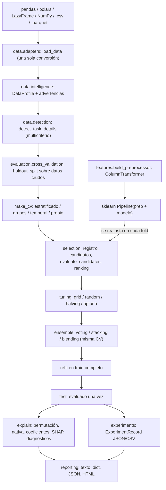

# SynaptIX AutoML 2.0 — guía de usuario

`sx.AutoPipeline` automatiza la experimentación de Machine Learning tabular
sin sacrificar la metodología: el conjunto de prueba se separa antes de
ajustar cualquier transformación, todo el preprocesamiento se reajusta dentro
de cada fold y los modelos que fallan nunca pueden ganar.

```bash
pip install synaptix                 # núcleo: pandas + scikit-learn
pip install synaptix[automl]         # + polars, pyarrow, optuna, psutil
pip install synaptix[explain]        # + shap
```

Ninguna dependencia opcional es necesaria para entrenar. Matplotlib solo se
importa al pedir gráficos (`report(plot=True)`).

---

## 1. Uso básico (una llamada)

```python
import synaptix as sx

df = sx.load_dataset("penguins")

pipe = sx.AutoPipeline()
pipe.fit(df, target="species")      # detecta, perfila, separa test, compara, ajusta y evalúa
pipe.report()                       # reporte en 12 secciones (validación y test por separado)

predicciones = pipe.predict(df_nuevo)          # datos crudos: nulos y categorías nuevas incluidos
pipe.save("model.pkl")
pipe = sx.AutoPipeline.load("model.pkl")
```

## 2. Uso intermedio

```python
pipe = sx.AutoPipeline(
    task="classification",
    models=["random_forest", "logistic_regression", "svm", "gradient_boosting"],
    cv=5,
    scoring="f1_weighted",
    tuning="random",
    n_iter=30,
    n_jobs=-1,
    random_state=42,
)
pipe.fit(df, target="species")

pipe.ranking_        # comparación en validación cruzada (train)
pipe.best_name_      # "random_forest", "logistic", ...
pipe.best_model_     # SynaptixModel ajustado (recibe features ya transformadas)
pipe.best_params_    # hiperparámetros elegidos por la búsqueda (None si ganaron los defaults)
pipe.results_        # métricas de test, evaluado una sola vez
```

## 3. Uso avanzado

```python
pipe = sx.AutoPipeline(
    task="regression",
    engine="polars",                    # lectura y perfilado con polars
    cv_strategy="kfold",
    scoring="neg_root_mean_squared_error",
    tuning="bayesian",                  # Optuna TPE con poda por fold
    time_budget=600,                    # segundos para selección + búsqueda
    n_jobs=4,
    ensemble="stacking",                # solo se elige si mejora la validación cruzada
    explain=True,
    random_state=42,
)
pipe.fit("ventas.parquet", target="importe", time_column="fecha")
pipe.report(plot=True, save="automl_report.html")
pipe.experiment_.to_json("experimento.json")
```

---

## 4. Arquitectura



| Módulo | Responsabilidad |
|---|---|
| `automl/data/adapters.py` | Detecta el tipo de entrada, elige el motor, convierte una sola vez |
| `automl/data/detection.py` | Detección de tarea multicriterio e inferencia de tipos de variable |
| `automl/data/intelligence.py` | `DataProfile`: nulos, cardinalidad, constantes, IDs, duplicados, desbalance, fuga |
| `automl/features.py` | `ColumnTransformer` por tipo de columna, selección de features, constantes |
| `automl/evaluation/metrics.py` | Métrica principal y secundarias, PR-AUC, MAPE seguro |
| `automl/evaluation/cross_validation.py` | Estrategias de validación y holdout según la estructura de los datos |
| `automl/selection/registry.py` | Catálogo de modelos, alias, presets, exclusión, compatibilidad |
| `automl/selection/ranking.py` | Evaluación con aislamiento de errores y ranking |
| `automl/tuning/` | Espacios de búsqueda unificados y estrategias con presupuesto |
| `automl/ensemble.py` | Voting, stacking y blending |
| `automl/explain.py` | Importancias, coeficientes, SHAP opcional, diagnósticos |
| `automl/parallel.py` | Un solo nivel de paralelismo + `threadpoolctl` |
| `automl/profiling.py` | Tiempo y memoria (RSS) por etapa |
| `automl/experiments.py` | `ExperimentRecord` reproducible |
| `automl/reporting.py` | Reporte de 12 secciones en texto, dict, JSON y HTML |

`synaptix.pipeline.AutoPipeline` y `synaptix.pipeline.grids` siguen
existiendo como fachadas: los imports anteriores funcionan sin cambios.

---

## 5. Parámetros de `AutoPipeline`

| Parámetro | Default | Descripción |
|---|---|---|
| `task` | `None` | `"classification"` / `"regression"`; si se omite se detecta con varios criterios |
| `models` | `None` | Nombres o alias (`"svm"`, `"logistic_regression"`), tuplas `(nombre, {params})`, estimadores sklearn o modelos SynaptIX |
| `exclude_models` | `None` | Nombres a excluir |
| `mode` | `"balanced"` | `"fast"`, `"balanced"`, `"exhaustive"`: candidatos, folds e iteraciones |
| `engine` | `"auto"` | `"pandas"`, `"polars"`, `"auto"` (ver §9) |
| `cv` | preset | Entero o splitter propio (`KFold(...)`, `PredefinedSplit`, ...) |
| `cv_strategy` | `"auto"` | `kfold`, `stratified`, `repeated`, `repeated_stratified`, `group`, `stratified_group`, `timeseries` |
| `cv_repeats` | `3` | Repeticiones de las estrategias `repeated*` |
| `scoring` | `accuracy` / `r2` | Métrica principal (nombres de sklearn o alias: `f1`, `rmse`, `mcc`, `pr_auc`, `mape`...) |
| `metrics` | según tarea | Métricas secundarias del ranking |
| `tune` / `tuning` | `True` / `"auto"` | `grid`, `random`, `halving`, `optuna`, `bayesian`, `auto` o `None` |
| `n_iter`, `tune_top_k` | preset | Combinaciones por búsqueda y modelos que se optimizan |
| `time_budget` | `None` | Segundos para selección y búsqueda |
| `param_grids` / `param_distributions` | `{}` | Rejillas o distribuciones propias por modelo |
| `test_size` | `0.2` | Fracción o filas de test; `None` = solo validación cruzada |
| `impute_strategy` | `"median"` | `mean`, `median`, `most_frequent`, `constant`, `knn` |
| `encode_method` | `"onehot"` | `onehot` u `ordinal` |
| `scale_method` | `"standard"` | `standard`, `minmax`, `robust` o `None` |
| `max_onehot_categories` | `20` | Categorías por variable; el resto se agrupa como *infrequent* |
| `drop_constant` | `False` | Elimina constantes dentro de cada fold (opt-in) |
| `feature_selection` | `None` | `variance`, `kbest`, `model` (dentro de cada fold) |
| `ensemble`, `ensemble_top_k` | `None`, `3` | `voting`, `stacking`, `blending` |
| `explain` | `True` | Importancias y diagnósticos sobre el test |
| `ignore_columns` | `None` | Columnas que no entran como features |
| `n_jobs`, `pre_dispatch` | `1`, `"2*n_jobs"` | Paralelismo de un solo nivel (CV o búsqueda) |
| `memory_optimization` | `False` | One-hot disperso; desactiva el perfilado con polars |
| `cache` | `False` | Cachea el preprocesamiento entre combinaciones (`joblib.Memory`) |
| `random_state` | `42` | Semilla de splits, modelos y búsquedas |

`fit(data, target, groups=None, time_column=None)`:

- `groups`: columna o vector de grupos (pacientes, clientes, zonas
  geográficas). Un grupo nunca se reparte entre train y validación/test.
- `time_column`: ordena los datos, usa las últimas filas como test y
  `TimeSeriesSplit` como validación. No entra como feature.

### Atributos tras `fit`

`task_`, `target_`, `task_detection_`, `profile_`, `feature_types_`,
`classes_`, `cv_strategy_`, `holdout_`, `ranking_`, `candidate_results_`,
`tuning_results_`, `ensemble_result_`, `best_name_`, `best_model_`,
`best_params_`, `pipeline_` (sklearn `Pipeline` completo), `cleaner_`
(compatibilidad), `cv_score_`, `results_`, `test_score_`,
`feature_importances_`, `model_importances_`, `coefficients_`,
`diagnostics_`, `timings_`, `profiler_`, `experiment_`, `warnings_`, `notes_`.

### Métodos

`fit`, `predict`, `predict_proba`, `report(plot=True, save=None)`,
`report_dict()`, `explain_shap(df)`, `get_params()`, `save(path)`,
`AutoPipeline.load(path)`.

---

## 6. Garantías metodológicas (y cómo se prueban)

| Garantía | Implementación | Prueba |
|---|---|---|
| Sin fuga de preprocesamiento | `Pipeline(prep + modelo)` dentro de `cross_validate` y de cada buscador | `tests/automl/test_leakage.py`: un transformador espía registra las filas de cada ajuste; nunca ve filas de test (grid, random, halving, optuna, stacking, blending) |
| Test evaluado una sola vez | Holdout sobre datos crudos antes de ajustar nada; no participa en selección ni búsqueda | `test_holdout_and_cv_folds_are_disjoint` |
| Selección de features sin fuga | Selector dentro del pipeline | Ruido puro con 3000 features: dentro de los folds la CV queda en ~0.5; el procedimiento con fuga da > 0.8 |
| Un modelo fallido no gana | Estado `failed` con el error; `pick_best` solo usa `ok` | `test_failing_model_never_wins`, `test_all_models_fail` (`AllModelsFailedError`) |
| Reproducibilidad | `random_state` en splits, modelos, búsquedas y Optuna | `test_reproducibility`, `test_optuna_tuning_is_reproducible` |
| Temporal sin mezclar pasado y futuro | Holdout cronológico + `TimeSeriesSplit`; stacking omitido; blending con reserva cronológica | `test_time_series_validation`, `test_stacking_is_skipped_for_time_series...` |
| Grupos disjuntos | `GroupShuffleSplit` + `(Stratified)GroupKFold` | `test_group_validation` |
| Sin datos en el pickle | No se guardan train ni test | `test_pickle_has_no_raw_data` |

Otras decisiones:

- **No se elimina nada en silencio.** Columnas constantes, IDs potenciales,
  duplicados o sospechas de fuga generan advertencias (`profile_.warnings`),
  no eliminaciones. Las filas sin target sí se descartan, con aviso.
- **Una variable numérica con pocos valores sigue siendo numérica.** Se
  avisa (`low_cardinality_numeric`) para que el usuario la convierta si es
  un código.
- **La detección de tarea combina criterios** (dtype, enteros, número y
  proporción de valores únicos, códigos consecutivos). Si es ambigua se
  avisa y `task=` siempre manda.
- **Métricas por defecto**: `accuracy` / `r2`. Con clases desbalanceadas se
  avisa y se sugiere `balanced_accuracy` o `f1_weighted`. MAPE excluye
  objetivos ≈ 0 y devuelve NaN con aviso si son más del 10 %.
- **Ensembles**: se evalúan con los mismos splits y solo se eligen si
  superan al mejor modelo individual en validación.
- **Importancias**: siempre se acompañan de la nota de que miden
  contribución predictiva, no efectos causales.

---

## 7. Modelos disponibles

| Clasificación | Regresión |
|---|---|
| `logistic` (`logistic_regression`, `logreg`) | `linear` (`linear_regression`, `ols`) |
| `decision_tree` | `ridge`, `lasso`, `elastic_net`, `bayesian_ridge` |
| `random_forest` (`rf`), `extra_trees` | `decision_tree`, `random_forest`, `extra_trees` |
| `gradient_boosting` (`gbm`), `hist_gradient_boosting` (`hgb`) | `gradient_boosting`, `hist_gradient_boosting` |
| `svm` (`svc`), `knn`, `naive_bayes` | `svm` (`svr`), `knn` |
| `gaussian_process` (solo `exhaustive` o explícito) | `gaussian_process` (solo `exhaustive` o explícito) |

`sx.automl.list_models("classification")` devuelve la lista. Los modelos
caros se omiten por defecto en datasets grandes (SVM > 20 000 filas,
procesos gaussianos > 2 000, KNN > 100 000) con una nota; pedirlos en
`models=` los incluye igualmente.

---

## 8. Validación, métricas y búsqueda

- `cv_strategy="auto"` decide según la estructura de los datos:
  `time_column` → `timeseries`; `groups` → `stratified_group` /
  `group`; si no, `stratified` / `kfold` con `shuffle=True` y semilla.
- Si la clase más rara tiene menos ejemplos que folds, los folds se
  reducen con aviso.
- Estrategias de búsqueda: `grid`, `random`, `halving` (successive halving;
  con < 1000 filas se usa `random` y se anota), `optuna` / `bayesian` (TPE
  con poda por fold), `auto` (rejilla si cabe en `n_iter`; si no,
  aleatoria). Un mismo espacio `("float", low, high, log)` /
  `("int", ...)` / `("cat", [...])` sirve para todas.
- `time_budget` corta la evaluación entre candidatos (los saltados quedan
  `skipped` en el ranking) y limita la búsqueda; siempre queda al menos un
  modelo válido evaluado.
- Presets:

| mode | folds | n_iter | modelos optimizados |
|---|---:|---:|---:|
| `fast` | 3 | 10 | 1 |
| `balanced` | 5 | 20 | 1 |
| `exhaustive` | 5 | 60 | 3 |

---

## 9. Motores de datos y rendimiento

Medido con `benchmarks/bench_engines.py` (resultados completos en
`benchmarks/results/README.md`; i5-7200U, 4 hilos, 12.8 GB, Python 3.15,
pandas 3.1, polars 2.1, mediana de 3 procesos nuevos):

| Etapa | 100 000 filas × 18 | 1 000 000 filas × 18 |
|---|---|---|
| Leer CSV a pandas: pandas / polars + `to_pandas` | 0.067 s / 0.155 s | 0.563 s / 0.707 s |
| Leer Parquet a pandas: pandas / polars + `to_pandas` | 0.068 s / 0.044 s | 0.281 s / 0.293 s |
| Perfilado: pandas / polars desde pandas | 0.577 s / 0.198 s | 9.53 s / 2.46 s |
| Memoria pico del perfilado: pandas / polars | 79 MB / 135 MB | 439 MB / 1007 MB |
| `AutoPipeline.fit` completo (HGB, cv=3): pandas / polars | 19.8 s / 19.5 s | — |

Conclusiones aplicadas a `engine="auto"`:

1. Leer con polars para terminar en pandas (scikit-learn lo necesita) no
   compensa: los archivos y DataFrames de pandas se leen con pandas.
2. El perfilado con polars es 2–4× más rápido desde ~1 millón de celdas,
   incluso contando `pl.from_pandas`, pero duplica la memoria pico. `auto`
   lo usa a partir de 1 000 000 de celdas si polars está instalado y
   `memory_optimization=False`. Por debajo (p. ej. 20 000 × 18) la
   ganancia medida es de 20 ms.
3. En el flujo completo el entrenamiento domina: el motor no cambia el
   tiempo total de forma apreciable. No se promete aceleración del
   entrenamiento por usar polars.

`engine="polars"` sigue siendo útil para entradas `LazyFrame` o archivos
con muchas columnas ignoradas (`ignore_columns` se aplica como proyección
antes de leer).

Paralelismo: `n_jobs` se aplica en un solo nivel (validación cruzada o
búsqueda); los estimadores internos usan `n_jobs=1` y las librerías BLAS se
limitan a 1 hilo con `threadpoolctl` durante esas secciones, para no
sobresuscribir CPU y memoria. `timings_` y `profiler_.to_frame()` muestran
tiempo y RSS por etapa (la memoria de los workers de joblib no se incluye).

---

## 10. Explicabilidad

- `feature_importances_`: importancia por permutación sobre el test,
  calculada con el pipeline completo (en columnas originales).
- `model_importances_`: importancias nativas (árboles) en las features
  transformadas; `coefficients_` en modelos lineales.
- `explain_shap(df)`: valores SHAP (requiere `synaptix[explain]`).
- `diagnostics_`: en clasificación, matriz de confusión, métricas por
  clase y pares de clases más confundidos; en regresión, estadísticos de
  residuos, los mayores errores y la correlación |residuo| vs. predicción
  (señal de heterocedasticidad).
- `report(plot=True)` dibuja matriz de confusión y curvas ROC / PR, o
  residuos, además de las importancias.

Todas estas medidas describen qué usa el modelo para predecir; no son
efectos causales.

---

## 11. Reportes y experimentos

`report(plot=True, save=None)` imprime 12 secciones: dataset, tarea,
variables, calidad de datos, modelos evaluados, ranking, **validación
(CV en train)**, **test (evaluado una vez)**, hiperparámetros,
importancias, tiempos y advertencias metodológicas. Con
`save="reporte.html"` genera un HTML autocontenido (gráficos en base64);
con `save="reporte.json"` exporta los datos y el registro del experimento.

`experiment_` (`ExperimentRecord`) guarda id, fecha, configuración
completa, versiones (Python, synaptix y dependencias), semilla, forma y
tipos de los datos, ranking, búsqueda, ensemble, modelo elegido, métricas,
tiempos y advertencias. `to_json(path)`, `to_csv(path)` y
`ExperimentRecord.from_json(path)`.

---

## 12. Benchmarks frente a otras herramientas

`benchmarks/bench_automl.py` compara SynaptIX (`fast`, `balanced`) con un
pipeline de scikit-learn escrito a mano (con y sin `RandomizedSearchCV`) y
con FLAML (mismo presupuesto de tiempo que `synaptix_balanced`). PyCaret y
AutoGluon no se pudieron instalar en Python 3.15 (fijan versiones de numpy
y scipy que no compilan); el script los registra como no disponibles en vez
de inventar resultados. Las tablas completas (balanced accuracy, RMSE,
preprocesamiento, ajuste final, inferencia, modelo elegido por semilla) están
en `benchmarks/results/README.md`.

Mismo split 80/20 para todas las herramientas, 3 semillas (0, 1, 2), cada
ejecución en un proceso nuevo. Métrica de prueba: media ± desviación entre
semillas; tiempo y memoria pico: mediana. Datasets sintéticos con 10
numéricas, 2 categóricas (5 y 40 niveles) y ~5 % de nulos.

| dataset | filas | sklearn base | sklearn random search | synaptix fast | synaptix balanced | FLAML (mismo tiempo) |
|---|---:|---:|---:|---:|---:|---:|
| penguins (accuracy) | 344 | 0.9758 ± 0.0084 · 0.4 s | 0.9855 ± 0.0145 · 13.0 s | 0.9855 ± 0.0000 · 4.3 s | **0.9903 ± 0.0084** · 17.2 s | **0.9903 ± 0.0084** · 17.6 s |
| clasificación (accuracy) | 5 000 | 0.8317 ± 0.0132 · 1.1 s | 0.8350 ± 0.0155 · 36.0 s | **0.8380 ± 0.0070** · 18.7 s | 0.8353 ± 0.0072 · 67.7 s | 0.8290 ± 0.0087 · 68.9 s |
| clasificación (accuracy) | 50 000 | 0.8422 ± 0.0022 · 2.8 s | 0.8425 ± 0.0030 · 72.3 s | **0.8433 ± 0.0029** · 60.8 s | — | 0.8411 ± 0.0018 · 62.4 s |
| regresión (R²) | 5 000 | 0.9234 ± 0.0073 · 0.9 s | 0.9243 ± 0.0060 · 30.9 s | 0.9253 ± 0.0082 · 23.1 s | **0.9301 ± 0.0081** · 63.5 s | 0.9233 ± 0.0199 · 63.9 s |
| regresión (R²) | 50 000 | 0.9389 ± 0.0029 · 2.7 s | 0.9390 ± 0.0028 · 63.6 s | 0.9397 ± 0.0029 · 136.2 s | — | **0.9405 ± 0.0026** · 137.5 s |

Memoria pico (mediana): scikit-learn 6–80 MB; synaptix fast 10–114 MB salvo
regresión con 50 000 filas (291 MB); FLAML 26–163 MB. `synaptix_balanced`
solo se ejecuta hasta 10 000 filas; FLAML recibe el tiempo que tardó
`synaptix_balanced` (o `synaptix_fast` cuando no hay balanced).

Conclusiones (solo lo que los datos sostienen):

- **Calidad.** SynaptIX obtiene la mejor media en 3 de los 5 escenarios,
  empata con FLAML en penguins y FLAML gana en regresión con 50 000 filas.
  Pero la distancia entre la mejor y la segunda herramienta (0.000–0.005)
  es del mismo orden que la desviación entre semillas (0.002–0.020): con 3
  semillas **no es estadísticamente concluyente**. Lo defendible es que SynaptIX iguala a un random search de
  scikit-learn bien configurado y a FLAML con el mismo presupuesto, no que
  los supere.
- **Estabilidad.** `synaptix_fast` tiene menor desviación que el random
  search de scikit-learn en penguins (0.0000 frente a 0.0145) y en
  clasificación con 5 000 filas (0.0070 frente a 0.0155); en el resto son
  similares.
- **Tiempo.** Comparar y optimizar varios modelos cuesta: `synaptix_fast`
  tarda entre 12 y 50 veces más que un único HistGradientBoosting por
  defecto. Frente al random search de scikit-learn (un solo modelo, 10
  combinaciones), `synaptix_fast` es más rápido en 4 escenarios (penguins
  4.3 s frente a 13.0 s; clasificación con 5 000 filas 18.7 s frente a 36.0 s)
  y más lento en regresión con 50 000 filas (136 s frente a 64 s), donde la
  selección de modelos ocupa la mayor parte (111 de 134 s en la semilla 0).
  Midiendo el ranking por modelo, casi todo ese tiempo es `random_forest`
  (45 s por ajuste en 40 000 filas frente a 1.6 s de
  `hist_gradient_boosting`). Con datos grandes conviene
  `exclude_models=["random_forest"]` o un `time_budget`.
- **Memoria.** SynaptIX usa más memoria pico que scikit-learn (perfilado,
  varios candidatos, importancias). El caso alto es regresión con 50 000
  filas (291 MB frente a 77 MB).
- **Cuándo no usarlo.** Si ya sabes que HistGradientBoosting es adecuado y
  el tiempo importa, el baseline de scikit-learn logra al menos el 98.5 % de
  la mejor métrica en estos escenarios, en una fracción del tiempo. AutoPipeline aporta cuando no sabes qué modelo
  usar, cuando los datos tienen problemas que conviene detectar (nulos,
  fuga, desbalance) o cuando necesitas trazabilidad (ranking, experimento,
  reporte).

El notebook `how_use_synaptix.ipynb` (sección 13) compara además cada uno
de los 27 modelos envueltos con su equivalente de scikit-learn: mismas
predicciones con los mismos parámetros, diferencias de valores por defecto,
métricas y costo del wrapper en `fit`/`predict`.

---

## 13. Pendiente

- Optimización multiobjetivo (p. ej. score vs. latencia); hoy la métrica
  principal decide y las secundarias se informan.
- Caché de pipelines entre ejecuciones de `fit` (hoy `cache=True` solo
  reutiliza dentro de una ejecución).
- Modelos de librerías externas (LightGBM, XGBoost, CatBoost) en el
  registro cuando estén instalados.
- Lectura por lotes / out-of-core para datasets que no caben en memoria:
  hoy los datos se materializan en pandas antes de scikit-learn.
- Medición de memoria de los workers de joblib cuando `n_jobs > 1`.
- Comparación con PyCaret y AutoGluon en un entorno con Python ≤ 3.12.
- Abaratar `random_forest` en `mode="fast"` con datos grandes (p. ej.
  `max_samples` o excluirlo desde cierto tamaño): domina el tiempo en
  regresión con 50 000 filas. Requiere repetir el benchmark antes de
  cambiar el preset.
- `SVC(probability=True)` está deprecado desde scikit-learn 1.9 y se
  elimina en 1.11. `SVMClassifier` y el candidato `svm` lo usan por
  defecto (para `predict_proba`): migrar a
  `CalibratedClassifierCV(SVC(), ensemble=False)` cambia las
  probabilidades y, en casos límite, las predicciones, así que conviene
  hacerlo con pruebas propias antes de 1.11.
- Los modelos de `synaptix.supervised` convierten la entrada a NumPy y no
  validan en `predict` que las columnas lleguen en el mismo orden que en
  `fit` (scikit-learn sí lo avisa con DataFrames). Añadir esa validación
  usando `feature_names_`. `AutoPipeline` no está afectado: selecciona las
  columnas por nombre.
- Validar el motor en el playground del sitio (Pyodide 0.26.4): las pruebas
  pasan con las mismas versiones (Python 3.12, scikit-learn 1.4.2, pandas
  2.2.0, numpy 1.26.4), pero no se ejecutaron dentro del navegador.
